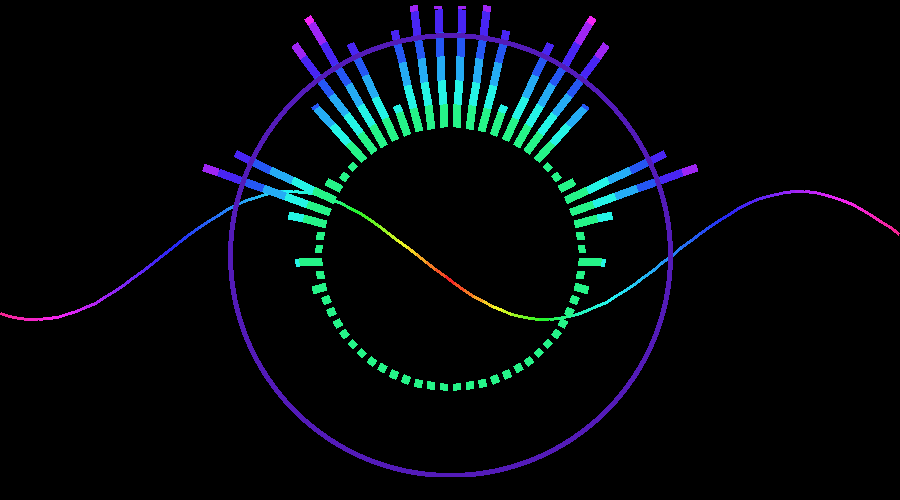
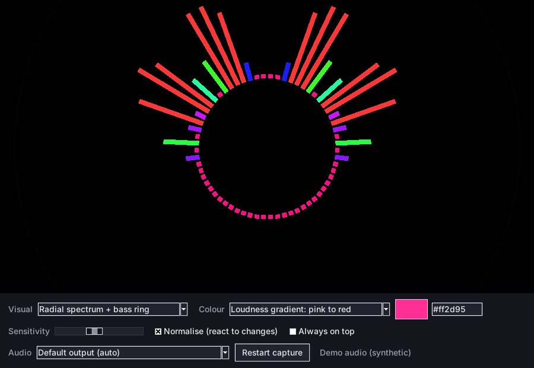
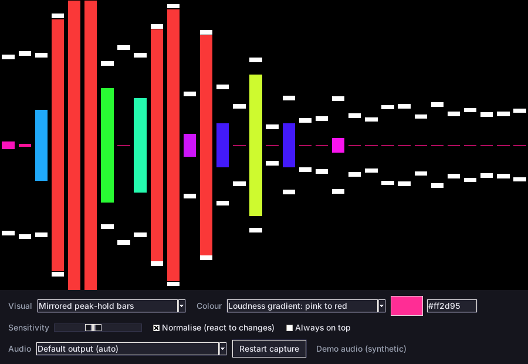
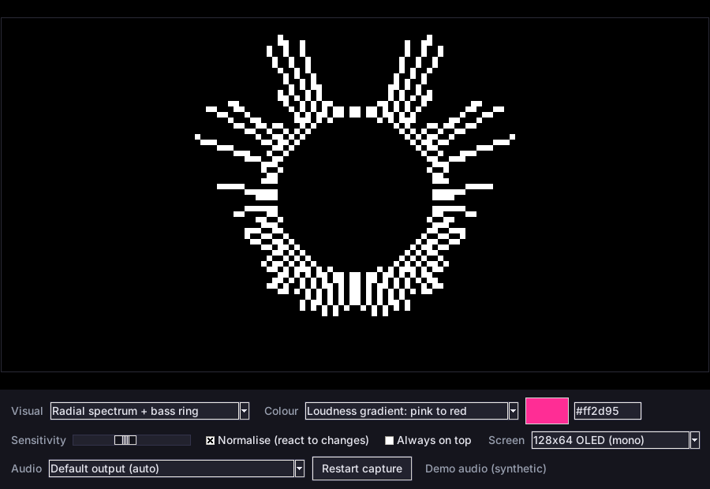
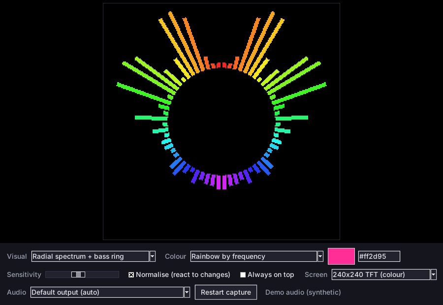
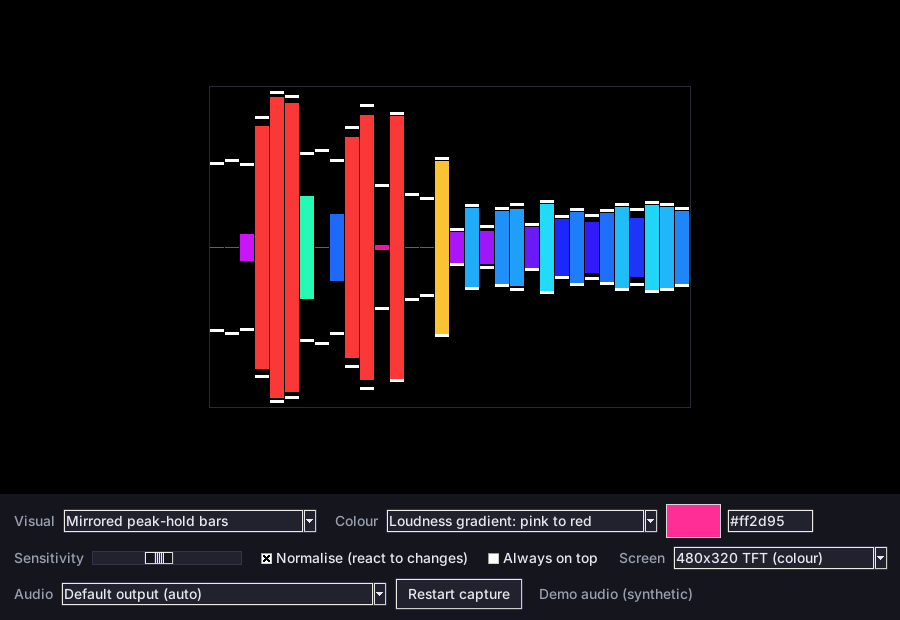

# Audio Visualiser

A Windows app that listens to everything your PC is playing (games, music, Discord, all of it) and draws it live as one of three visuals:

- **Radial spectrum + bass ring + waveform** (default): the radial spectrum below with a clean sine wave through the middle that follows the single strongest tone in the audio. The Line smoothness slider decides how quickly it follows changes.
- **Radial spectrum + bass ring**: 32 frequency bars around a circle that pulses with the bass, with a ring that shoots out on each beat.
- **Mirrored peak-hold bars**: bars grow from the centre line in both directions, with peak dots that fall slowly.

It captures audio with WASAPI loopback, so nothing needs to be routed through a virtual cable and the visualiser ignores your volume knob.

| Radial + waveform (default) | Radial, loudness gradient | Mirrored bars |
|---|---|---|
|  |  |  |

Screenshots use the built-in synthetic demo audio.

## Pixelated screen presets

Pick a **Screen** preset to see exactly what the visual would look like on a small display. The app draws at that resolution and scales it up with hard pixel edges, so you can judge a screen before buying it.

| 128x64 OLED (mono) | 240x240 TFT | 480x320 TFT |
|---|---|---|
|  |  |  |

Presets: 128x64 OLED (mono), 128x64 (colour), 160x128 TFT, 240x240 TFT, 320x240 TFT and 480x320 TFT. **Full window (smooth)** is the normal mode.

The mono OLED preset is strictly black and white like a real SSD1306 panel, so the ring fades out instead of showing greys. All colour modes, the hex box and the sensitivity slider work in every preset.

## Download

Grab `AudioVisualiser.exe` from the **Releases** page (tagged builds) or from the latest successful run under **Actions** (artifact `AudioVisualiser-windows`). There is nothing to install.

Windows SmartScreen may warn about an unsigned app the first time. Choose **More info**, then **Run anyway**. The exe is built from this repo by the workflow in `.github/workflows/build.yml`.

## Controls

| Control | What it does |
|---|---|
| Visual | Switch between the radial spectrum and the mirrored bars |
| Colour | Rainbow (red in the centre, through green and blue to pink the further out you go), loudness gradient (pink, purple, blue, green, yellow, red as it gets louder), or a custom colour |
| Swatch / hex box | Pick a colour or type a hex code such as `#00ffaa`. Setting one switches Colour to Custom. The box turns red if the code is invalid |
| Sensitivity | Scales how tall the bars and waveform are (0.05 to 3, default 1.6) and how loud a band has to be to reach red in the loudness gradient |
| Bass ring reacts to | **Kick** listens for sudden hits across the low and low-mid range (40 to 800 Hz), which suits drum kicks even over loud sustained bass. **Bass** listens only to 40 to 160 Hz. Press **K** to switch |
| Detection | How easily the ring fires (0.25 to 8). Raise it if kicks are being missed, lower it if it fires too often |
| Ring size | How thick and long-lasting the ring is (0.5 to 8) |
| Line smoothness | How smoothly the waveform follows changes in the strongest tone. Low reacts instantly, high glides |
| Normalise | Subtracts each band's running average so constant noise stays quiet and sudden hits pop. Turn it off to see raw levels |
| Always on top | Keeps the window above everything else |
| Screen | Full window, or a pixelated preset that mimics a small display |
| Audio | Follow the default output device, or pin a specific one |
| Restart capture | Re-detect the output device |

Keyboard shortcuts: **H** hide or show the controls, **V** switch visual, **K** switch the ring between Kick and Bass, **P** next screen preset, **R** restart capture, **F11** fullscreen, **Esc** leave fullscreen.

Settings are saved to `%APPDATA%\AudioVisualiser\settings.json` when you close the window.

### Audio device behaviour

The app follows your default output device. If you switch from speakers to headphones while it is running, it re-detects the device on its own after a few seconds of silence. You can also press **R**. If it keeps showing "no audio playing", pick your device from the Audio dropdown.

WASAPI loopback only delivers audio while something is playing, so a paused player simply shows an idle visualiser.

## Run from source

Requires Python 3.12 on Windows (tkinter is included with the python.org installer).

```
python -m venv .venv
.venv\Scripts\activate
pip install -r requirements.txt
python -m audiovis
```

To try it without any audio hardware (or on another OS), use the synthetic demo source:

```
python -m audiovis --demo
```

## Build the exe yourself

```
pip install pyinstaller
pyinstaller --noconfirm --clean --onefile --windowed --name AudioVisualiser --hidden-import pyaudiowpatch run.py
```

The exe appears in `dist\`.

## Releases

Pushing to `main` runs the tests, builds the exe and smoke-tests it (`AudioVisualiser.exe --selftest`, which cycles through every screen preset). Pushing a tag such as `v0.4.1` also publishes the exe as a GitHub release:

```
git tag v0.4.1
git push origin v0.4.1
```

## Tests

```
pip install numpy pytest
python -m pytest
```

The window tests need a display and are skipped automatically when there isn't one.

## How it works

1. `capture.py` opens a WASAPI loopback stream (via PyAudioWPatch), mixes it to mono and keeps the latest 2048 samples. Output devices running at 96 kHz or 192 kHz are averaged down to about 48 kHz first.
2. `analysis.py` applies a Blackman window and FFT, converts to decibels (-100 to -30 dB), smooths over time, and groups the result into 32 logarithmic bands from 40 Hz to 16 kHz. It also tracks a running average per band for normalisation and detects bass beats.
3. `visuals.py` turns the analysis into drawing shapes (lines, rectangles, a ring). `display.py` draws them either as smooth canvas items or, for the pixel presets, through `raster.py`, a small numpy rasteriser that draws at the preset resolution. `app.py` wires up the window and controls.

The analysis is deliberately the same maths the browser's Web Audio analyser uses, so a visual tuned in a web prototype looks the same here.
